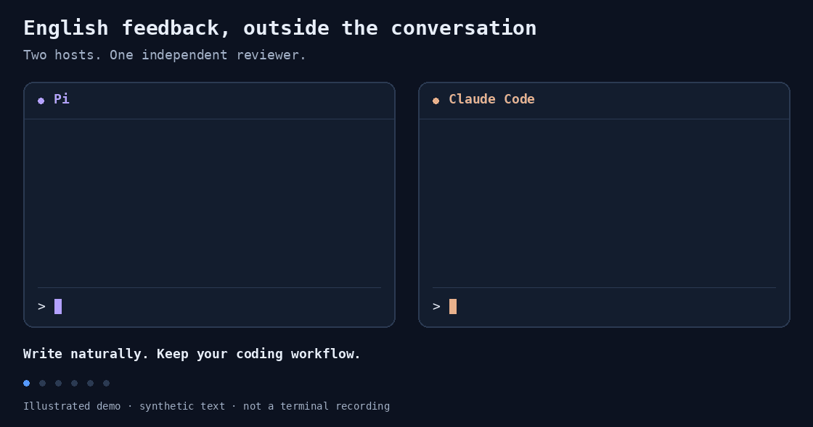

# Corrective feedback

Since we are deep into the sci-fi journey of talking to computers in natural
language, why not learn a few tricks along the way? This plugin spawns a
subagent to correct your English without polluting the main conversation:

It also logs the corrections to JSONL files, so you can plot your mistakes and
train your own flashy neural network.

## Quick start

Just send `https://github.com/rlschuller/corrective-feedback` to your agent and
ask it to adapt the project to your setup. I recommend using GPT Sol 6.1 or
better to correct your English, since GPT Luna 6 is not reliable enough for
this task. My own setup is a bit unusual: I use Pi with
`openai-codex/gpt-6.1-sol` to correct what I write in both Claude Code and Pi,
so technically Pi is an "obligatory" dependency. Until your agent fixes it.

## Use

Reviews are on by default; suggestions are off. When the reviewer spots an
error, the correction appears above the input field as blue text. If no
corrections appear, either your setup is broken or you made no mistakes.

| Command | Action |
|---|---|
| `/feedback` | Show status and configuration paths |
| `/feedback off` / `/feedback on` | Disable / enable reviews |
| `/feedback clear` / `/feedback last` | Hide / recall corrections |
| `/feedback model provider/id` | Change the reviewer for this session |
| `/feedback reload` | Reload configuration |

**Ctrl+N** hides or recalls feedback without changing your draft (needs a one-time setup).

## Privacy and cost

Obligatory warning, since my agents are **very** worried about it:

Please turn off feedback (`/feedback off`) before sending messages with
sensitive information. Your messages are sent to whichever service you chose
for corrections. Naturally, these subagent corrections will consume tokens.
Additionally, the log feature stores the corrections locally.

PS: Now even the humans will understand how the log feature works, right, Claude?

## More

- [Full guide](docs/guide.md): installation, configuration, and commands.
- [Development and tests](docs/guide.md#development-and-verification).
- [Local statistics and plots](docs/guide.md#update-the-time-series-plot) (generated files are ignored by Git).
